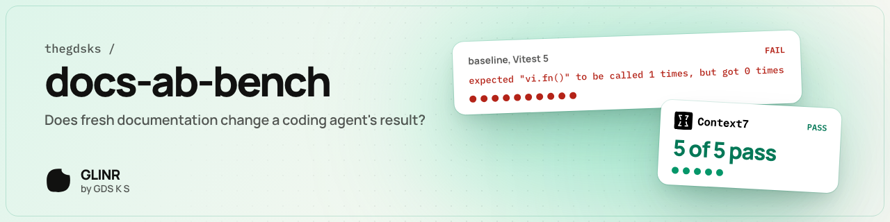

Sponsored by Upstash. I built and ran this benchmark myself.

<p align="center"></p>

# docs-ab-bench

A small harness that runs the same coding task twice and records raw numbers.

- Arm `baseline`: the model gets the task and file tools.
- Arm `context7`: the same prompt and tools, plus a docs search tool backed by [Context7](https://context7.com?utm_source=gagan-deep-singh).

Each run happens in a fresh temp folder, then the subject's own check script decides pass or fail. Results are written as one JSON file per run and summarized per subject and mode. No scoring beyond pass or fail.

## Install

Needs Node 22.22 or newer.

```sh
npm install
cp .env.example .env   # then fill in the keys
```

## Keys

| Variable | Needed for |
| --- | --- |
| `ANTHROPIC_API_KEY` | the `ai-sdk` driver (the `claude-code` driver uses your own CLI login or this key) |
| `CONTEXT7_API_KEY` | the `context7` arm. Create a free key at https://context7.com/dashboard?utm_source=gagan-deep-singh, the free tier is enough |

The `context7` arm with the `ai-sdk` driver fails before any run starts if `CONTEXT7_API_KEY` is missing.

Every threshold and default (run count, model, timeouts, step override, shell allow-list, output limits) comes from a flag or an env var, see `.env.example`.

## Run

```sh
npx tsx src/cli.ts list
npx tsx src/cli.ts run --subject <id|all> --arm both --n 5 --mode oneshot --driver ai-sdk --model <model-id> --batch my-batch
npx tsx src/cli.ts report --batch my-batch
```

Flags:

- `--arm baseline|context7|both` (default `both`)
- `--mode oneshot|agentic`: `oneshot` gives file tools only and checks once at the end. `agentic` also allows a shell (`npm`, `npx`, `node`, `ls`, `cat`, plain commands only) up to the subject's `maxSteps`.
- `--driver ai-sdk|claude-code`: `ai-sdk` runs a tool loop through the AI SDK. `claude-code` spawns `claude -p` in the temp folder with a strict MCP config (empty for baseline, the remote Context7 server for the other arm).
- `--max-steps <int>` overrides the subject's `maxSteps` (also `BENCH_MAX_STEPS`). The `claude-code` driver has no turn limit flag, so there it only applies to the `ai-sdk` driver.
- `--force` reruns files that already exist. Without it, existing run files are skipped, so an interrupted batch can be resumed.

Set `BENCH_DOCS_HINT=1` to add one line to the context7 arm's prompt: "Before you write code, use the Context7 tools to look up the current documentation for the libraries involved." Without it, the tool is available but the agent often never calls it. Use a different `--batch` name for each setting so runs stay separable.

Set `BENCH_DOCS_HINT_PLACEMENT=claude-md` to put that line in a `CLAUDE.md` file in the project folder instead of the prompt. The prompt is then identical for both arms.

Dependencies of each subject are installed once into a cache under the system temp folder and cloned into every run.

`npx tsx src/cli.ts verify [--subject <id|all>]` prepares each workdir exactly like `run`, then checks that the untouched fixture fails, `reference/correct` passes and `reference/stale` fails.
It prints one line per subject and exits non-zero if any expectation is wrong. Run it after changing a fixture, a check or the dependency cache.

## Results

Run on 2026-11-23 and 2026-11-24 with Claude Code (model alias `sonnet`), five runs per arm per cell, 120 runs in total. The libraries were chosen because their APIs changed in 2026. Raw runs are in `runs/`, one JSON file each. Each cell shows passes out of runs and the mean tokens per run. The one-pass baseline was run twice with an identical prompt (an earlier batch, then the batch shown), so pooled it is 0/10 for Vitest 5, 8/10 for SvelteKit 3 and 10/10 for AI SDK 7.

| Library | Mode | Baseline | Context7, told to use it | Context7, not told |
| --- | --- | --- | --- | --- |
| Vitest 5 | one pass | 0/5 (35k tokens) | 5/5 (64k tokens) | 2/5 (39k tokens) |
| Vitest 5 | with a shell | 3/5 (106k tokens) | 5/5 (98k tokens) | not run |
| SvelteKit 3 | one pass | 4/5 (83k tokens) | 5/5 (67k tokens) | 3/5 (87k tokens) |
| SvelteKit 3 | with a shell | 5/5 (49k tokens) | 5/5 (74k tokens) | not run |
| AI SDK 7 | one pass | 5/5 (60k tokens) | 5/5 (59k tokens) | 5/5 (76k tokens) |
| AI SDK 7 | with a shell | 5/5 (95k tokens) | 5/5 (105k tokens) | not run |
| React Router 8 | one pass | 3/5 (53k tokens) | 5/5 (77k tokens) | not run |
| Astro 7 | one pass | 5/5 (161k tokens) | 4/5 (148k tokens) | not run |
| TypeScript 6 | one pass | 5/5 (37k tokens) | 5/5 (52k tokens) | not run |

### Where the instruction lives

One pass, five runs per cell, same model. The Context7 arm got the same line either in the task prompt or in a `CLAUDE.md` in the project folder.

| Library | Plain agent | Line in the prompt | Line in CLAUDE.md |
| --- | --- | --- | --- |
| Vitest 5 | 0/5 | 5/5 | 0/5 |
| SvelteKit 3 | 4/5 | 5/5 | 2/5 |
| React Router 8 | 3/5 | 5/5 | 4/5 |

With the line in `CLAUDE.md` the agent called Context7 once per run, always to resolve the library and never to read its docs. Raw runs are in `runs/claudemd-oneshot/`. Small sample and one model, so read it as a signal.

What this does and does not show:

- The Context7 arm only helped when the prompt told the agent to use it. Set `BENCH_DOCS_HINT=1` to reproduce that arm.
- With a shell the baseline often fixes itself from the build error, so the gap narrows or closes.
- Where the model already knows the library (AI SDK 7, TypeScript 6) there is no difference, and Context7 costs extra tokens.
- Five runs per cell is small. One model, one agent driver, and tasks written by me. Treat the numbers as a worked example, not a verdict.
- Sponsored by Upstash. The tasks, checks and raw data are all here so you can run your own.

## Add a subject

Create `subjects/<id>/` with:

```
subject.json   matches subject.schema.json
task.txt       the prompt given to the agent
fixture/       starting project, pin the library version in fixture/package.json
check.sh       executable, runs inside the finished workdir, exit 0 means pass
reference/     optional reference solution
```

`subject.schema.json` in the repo root is the contract. `subjects/toy-hello` is a tiny working example used by the tests.

## Read the results

Each run is `runs/<batch>/<subject>-<arm>-<n>.json`, validated against `run.schema.json` before it is written. `report` prints and writes `runs/<batch>/summary.json` with, per subject and mode and for each arm: runs, pass rate, mean and median total tokens, mean steps, mean duration in ms and mean Context7 calls, plus the difference between arms (`context7` minus `baseline`).

Notes on the numbers:

- `ai-sdk` tokens are summed over all steps. `claude-code` input tokens include cache reads and writes, and `costUsd` comes from the CLI. For `ai-sdk`, `costUsd` is null.
- `claude-code` runs use the stream form of the CLI output (`--output-format stream-json`), because the single JSON result does not list tool calls. The final result line carries the same totals.
- Compare runs only within the same driver, model and mode.

## Develop

```sh
npx vitest run
npx tsc --noEmit
```
